# Part 15 review evidence

Code-only review; no deployment, no remote Cloudflare action. Base: `b82aa73` (PR #19). Node 24.19.0, pnpm 11.19.0.

## Changes
- Build the validated player import graph with pinned esbuild 0.25.12: one main bundle, shared chunks, and separate lazy admin/local bundles. Initial player load uses 3 JS files; the build lists 8 files total. Admin UI code and desktop-only policy are unchanged.
- Hash JS filenames at build time; use full SHA-256 names for allowlisted CSS/static assets. Only verified hashed static paths get `public, max-age=31536000, immutable`. HTML, private manifest endpoint, API responses and errors remain `no-store`.
- Keep the exact-byte manifest SHA-256 pin (`ASSET_MANIFEST_SHA256`) and per-file SHA-256 validation before cache eligibility. API cache headers cannot override edge no-store. Source scope, relative-import validation, explicit asset allowlist, size bounds, traversal/symlink rejection and atomic manifest write remain enforced.
- Load only selected conversation history, then load other history on selection. Welcome audio was already demand-driven; preserve that and explicitly set `preload=none`, with regression coverage. No startup welcome-audio downloads were observed before or after.
- Player-only mobile layout: combined login/register plus invite on one row, remaining count directly beneath that action group; exhausted hint is a slim banner. 16 px card gutters, viewport/safe-area sizing, internal message scrolling and keyboard-visible composer.
- Follow-up requirements: orbit only on home/browse, not single-person chat; mobile vertical orbit radius is 30% of the former radius, role circles 54 → 45.9 px (-15%), with 48 px hit areas. Compact card-internal title uses 44 px row, 15 px text and 8 px horizontal padding, with message top spacing 24 → 12 px. Outer logo/account header is not additionally compressed by this last change. Desktop card becomes taller; desktop header/orbit styling unchanged.

## Measurement (honest scope)

| Cold guest load | Requests before ready | Encoded response body bytes | Ready time |
| --- | ---: | ---: | ---: |
| Before (`b82aa73`) | 24 | 247,748 | 2,553.5 ms |
| After (final source) | 8 | 179,350 | 1,791.8 ms |

These are single localhost Chromium/IAB measurements, **not Safari Web Inspector measurements**. A test-only synthetic preview reuses the repository static server and synthetic provider contract, adds 150 ms response latency and a shared 1.6 Mbps payload budget, and has no external provider or real account data. Separate ports/build snapshots give cold asset paths. A small identical test-only observer records ready after the wired player header appears plus two animation frames. Payload totals include the observer; exclude HTTP headers. The final run includes a favicon 404 request (zero payload). Input readiness was checked manually; this is a readiness proxy, not a standardized TTI metric. Both traces contain no admin bundle and no audio request. The reported one-minute production load was not reproduced locally. The ≤10 / <5s target is met only by this substitute profile; Safari 4G acceptance remains open.

## Visual evidence

Screenshots live exclusively on `review/part-15-screens`, not the feature branch. All content is synthetic.
- Native Safari: iPhone 17 Pro / iOS 26.5 before/after guest and final keyboard screenshot. User opened the keyboard because simulator input automation failed. Final composer is fully visible above Safari's native accessory toolbar, and chat has no orbit.
- Chromium 360 px before/after: guest, exhausted trial, signed-in, account sheet, invite sheet, several bubbles. Final chat geometry/screens at 360, 390, 430 px: root width equals scroll width, card gutters 16 px, title/back target 44 px. Desktop 1440×1000 after screenshot included.
- `interim/` keyboard screenshot documents the discovered orbit bug before its fix; it is NOT final acceptance evidence.

## Deviations / acceptance still open

- User replaced the original SE/16/16 Pro Max simulator matrix with iPhone 17 Pro. Boundary widths were checked in Chromium, not additional iOS models.
- Simulator screenshots work, but simulator clicks fail with “no available window”; Safari Develop detects the device, but inspector activation fails. Therefore Safari Inspector throttling and the complete native before/after state matrix (including a baseline keyboard screenshot) could not be completed. Actual Android Chrome was not available. This PR stays draft until those checks are completed.
- Measurement uses an isolated synthetic fixture harness instead of the full repository provider-local startup; repository local HTTP and restart scripts are checked separately. This avoids real credentials/providers and makes the before/after workload identical.
- Safari's native address/accessory/keyboard UI remains; CSS does not remove it. The web-owned orbit/footer space is removed in chat.
- Narrow named test exceptions only replace obsolete unbundled output paths/file counts with hashed-bundle assertions; no tests are deleted/skipped and security assertions are retained/strengthened. `tests/web/unit/web-text-policy.test.ts` and its pinned hashes are untouched.

## Checks

- `pnpm check`: **1122/1122 passed**, 0 failed/skipped/cancelled; 364.32 s test phase. Includes formatting, pinned prompt check and all TypeScript checks. Main had 1113: **+9 tests**.
- `pnpm web:player:build`: PASS, 8 manifest-listed files.
- `pnpm check:web:local-http`: PASS (4 rounds, restart, private audio, cursor and same-IP limit).
- `pnpm check:web:restart`: PASS (synthetic local-2 restart TLS).
- `git diff --check`: PASS. Tests ran serially; no concurrent suites.

## Files changed

- `apps/player-web/src/app/main.ts`
- `apps/player-web/src/features/prototype/preview.ts`
- `apps/player-web/src/features/prototype/provider-binding.ts`
- `apps/player-web/src/styles/main.css`
- `apps/player-web/tests/components/account-sheet.test.ts`
- `apps/player-web/tests/components/mobile-layout.test.ts`
- `apps/player-web/tests/components/provider-binding.test.ts`
- `apps/server/cloudflare/web-assets.ts`
- `apps/server/platform/web-local-static.ts`
- `package.json`
- `pnpm-lock.yaml`
- `pnpm-workspace.yaml`
- `scripts/build-web-player.ts`
- `scripts/test-web-local-http.ts`
- `tests/web/e2e/web-player-static-c.e2e.test.ts`
- `tests/web/unit/web-cloudflare-edge.test.ts`
- `tests/web/unit/web-player-build.test.ts`
- `workers/web-cloudflare/edge.ts`
- `apps/server/platform/web-asset-cache.ts`

## Gallery

### Native iPhone 17 Pro Safari

Before guest:

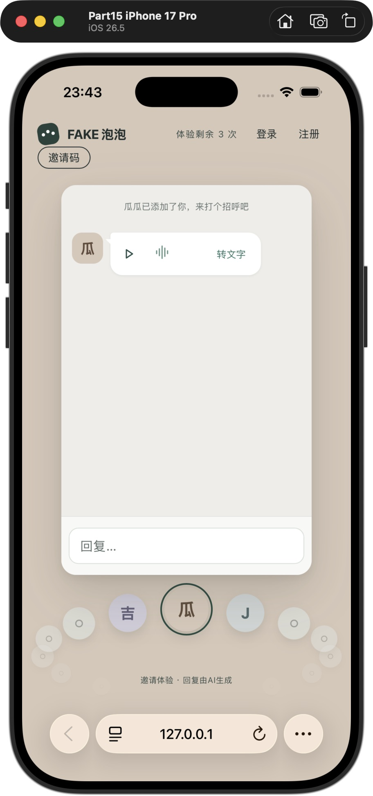

After guest:

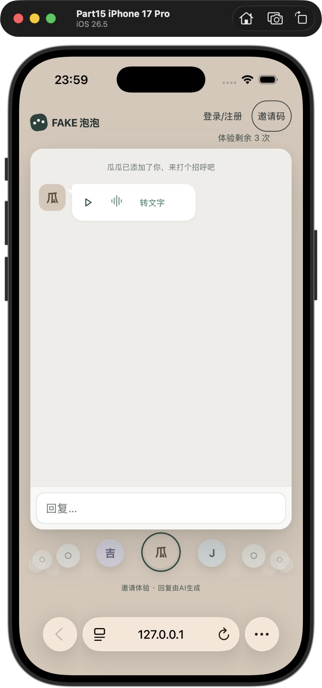

Final keyboard-open chat (user-assisted; compact card title, no orbit):

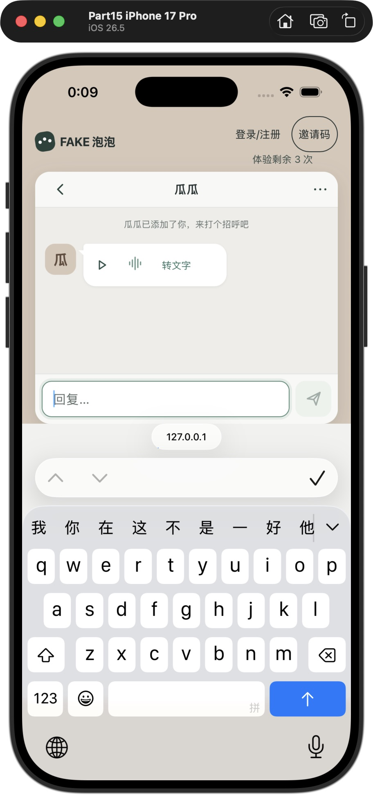

### Chromium phone-width evidence (not Safari/Android)

| State | Before, 360 px | After, 360 px |
| --- | --- | --- |
| guest | 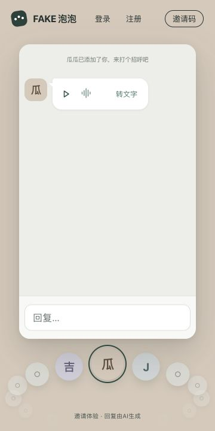 | 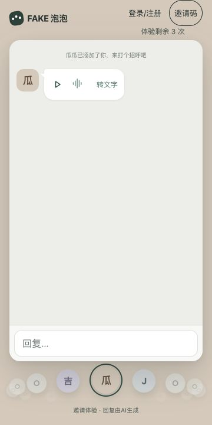 |
| exhausted | 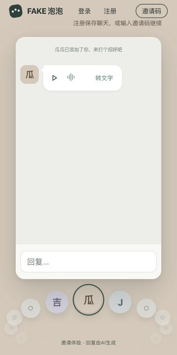 | 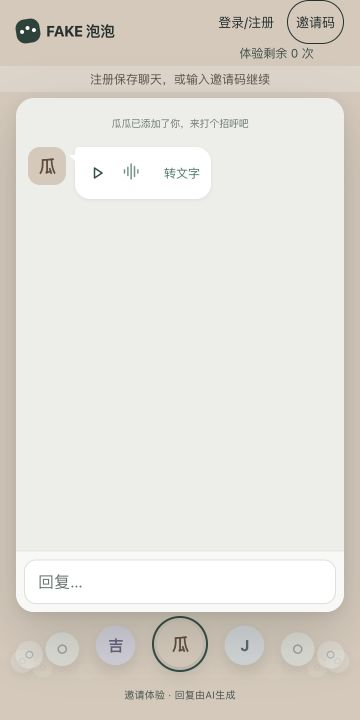 |
| signed-in | 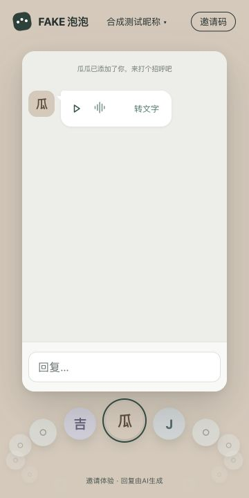 | 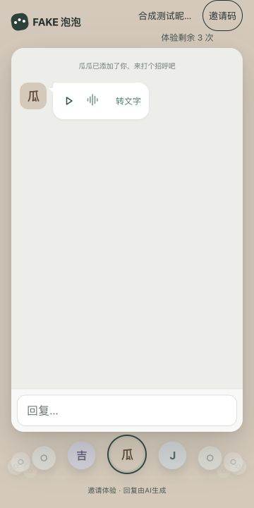 |
| account |  | 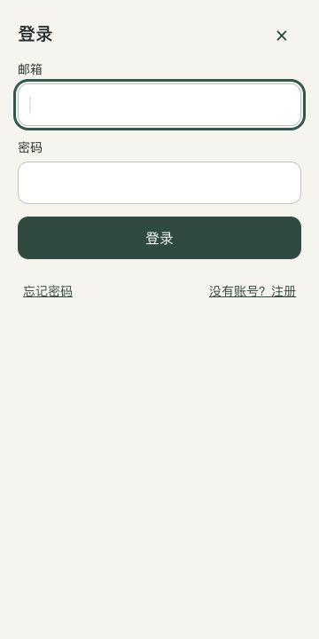 |
| invite | 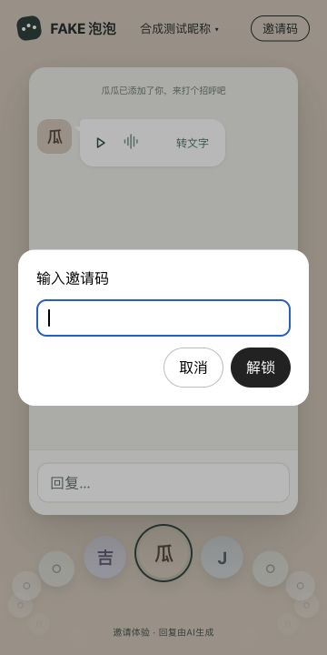 | 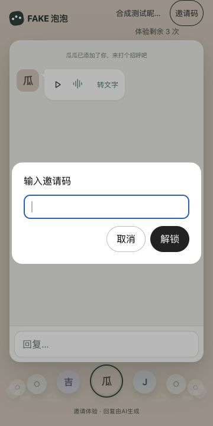 |
| bubbles | 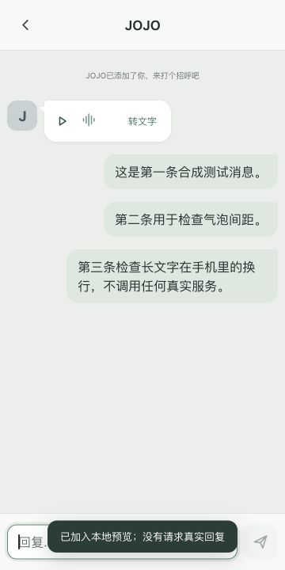 | 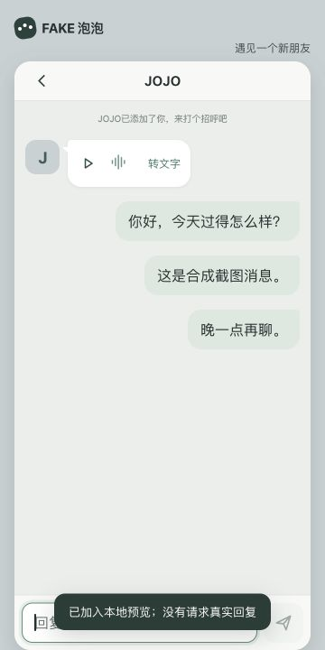 |

Measurement JSON, final geometry JSON and the two test-only harness scripts accompany these images. Copy the harness scripts into `work/part15/` of the feature checkout to reproduce; the screenshot branch intentionally does not contain application source or build output.
