# Part 44 — Fix 3: Android home cards, nickname rendering (before / after)

**Needs the owner's OK before it is finalised.** Left = today (`origin/main`), right = the fix. Same names, same card, only the name text changes
(the voice bar is placed from the name's size, as in Part 41, so it follows the name).

Names: 憨憨 · 三点水的vuan · Cactus Kelly · Reflection · Jacqueline Gypsy · 十二个字的名字好长啊真的 · fjgpqy Jyqg · 阿杰Jay · Wuthering Heights · 陈吉米 · Q.Z · 小A · Emma · 秦川 · JOJO
(5 rows per picture, in that order.)

## Android emulation, 412×915 @3.5 (Chromium; Galaxy S23 Ultra size, not the real device)
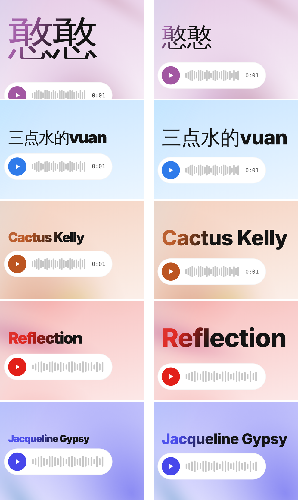
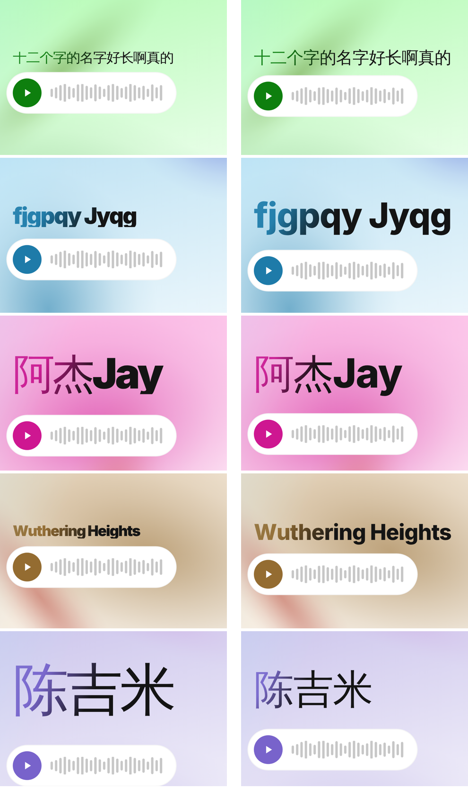
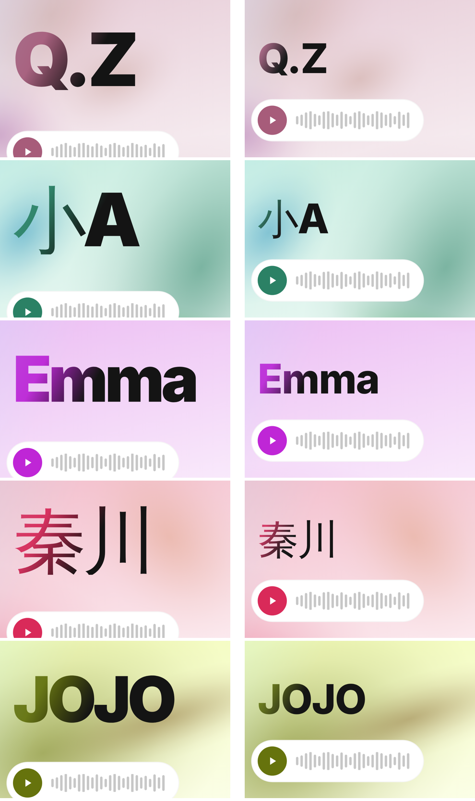

## Desktop 1440×900
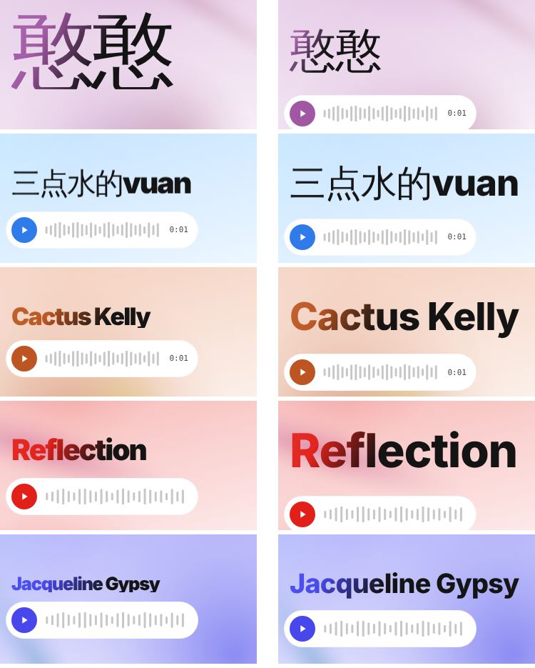
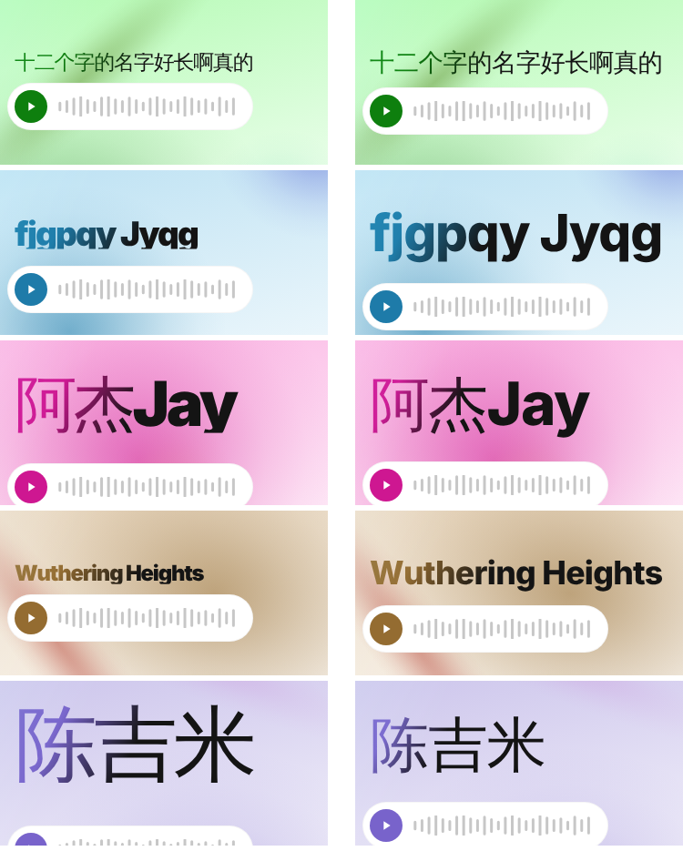
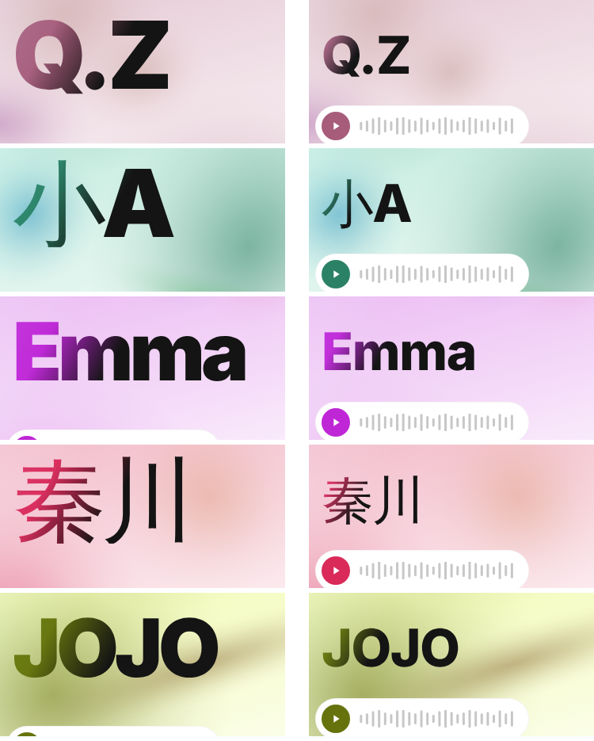

## iOS WebKit
Not available in this build environment (no WebKit binary), so there is NO iOS screenshot here. It still needs a look on a real iPhone.

## What was wrong (before)
- Size: a table by name length (`0.84 / ems`, capped at 0.36 of the card) → 憨憨 filled the card, a 12-character name was tiny; sizes jumped between characters.
- Clipping: the gradient is `background-clip: text` on a box with `line-height: 0.95`, so the gradient only paints inside that box — descenders (g, y, p, q, j) and the overhang of the last glyph (the −0.05em letter-spacing pushes it past the box) are cut.
- Mixed scripts: weight 900 does not exist for CJK, so the CJK fell back to a lighter weight while the Latin was heavy and in a different face, which made 「三点水的vuan」 look like two names.
- Not the cause: `overflow: hidden` (none on the name box).

## The fix
- One rule: fixed size 0.20 of the name box's width, shrunk only to fit the width (min 0.065), measured per card.
- The text sits in an inner box with padding (undone by negative margins), so the gradient covers descenders and overhang; letter-spacing −0.02em; line box unchanged.
- One font stack for Latin + CJK, one weight (800), no synthesised bold.

---
# Update (owner approved the board above; this adds the bold-CJK and iOS shots)
Re-shot with Noto Sans CJK installed (real bold weights, so the CJK now matches the Latin weight) and on iOS WebKit (Playwright WebKit 26.6, iPhone 15 profile). Left = `origin/main`, right = the fix. Names: 三点水的vuan · 阿杰Jay · 陈吉米 · 秦川.

## Android emulation 412×915 @3.5
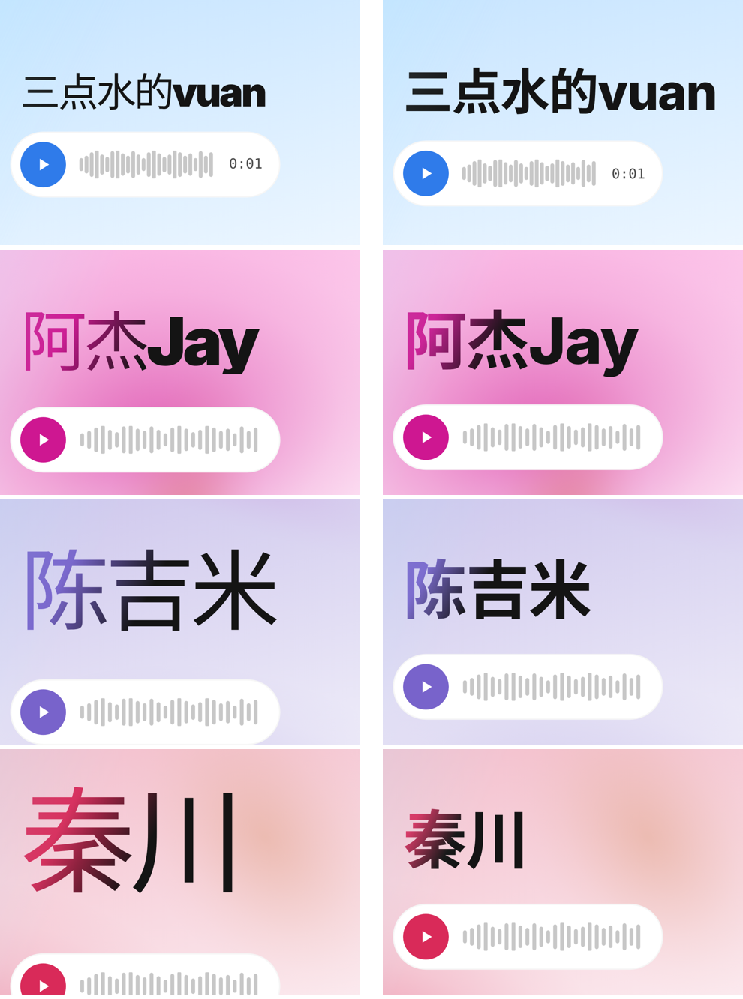
## iOS WebKit (iPhone 15)
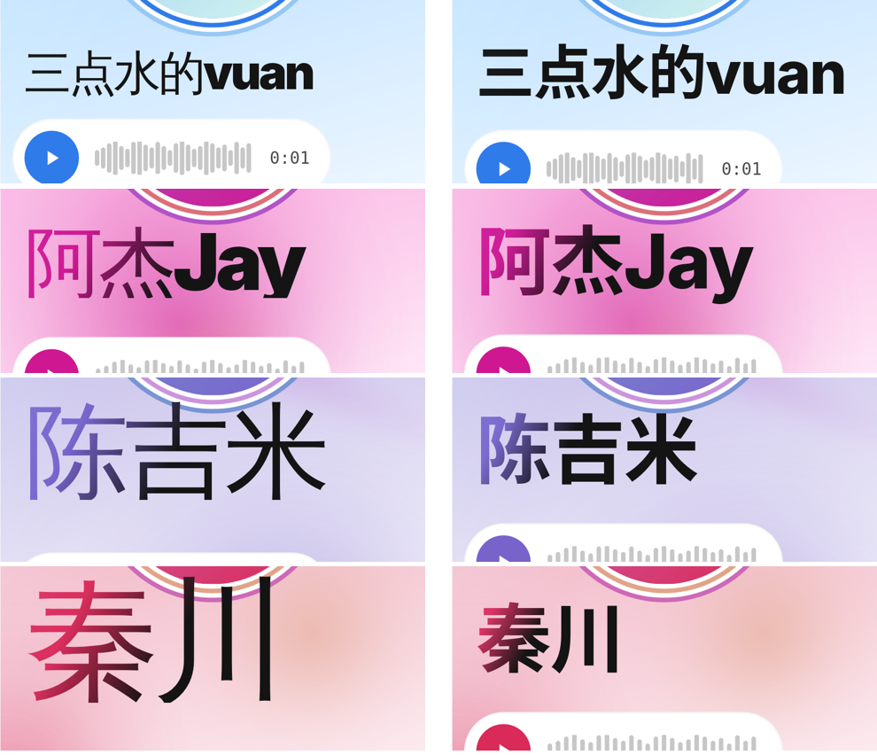
## Desktop 1440
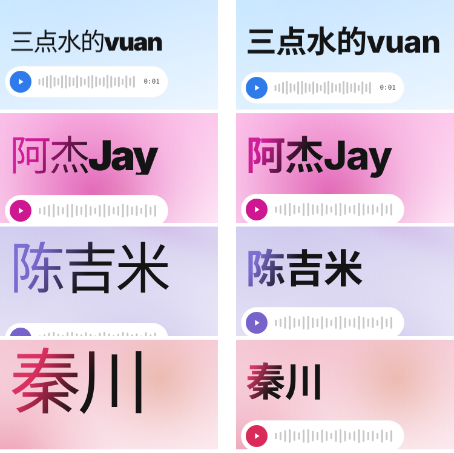

All 15 names again on Android with the CJK font (5 rows per picture):
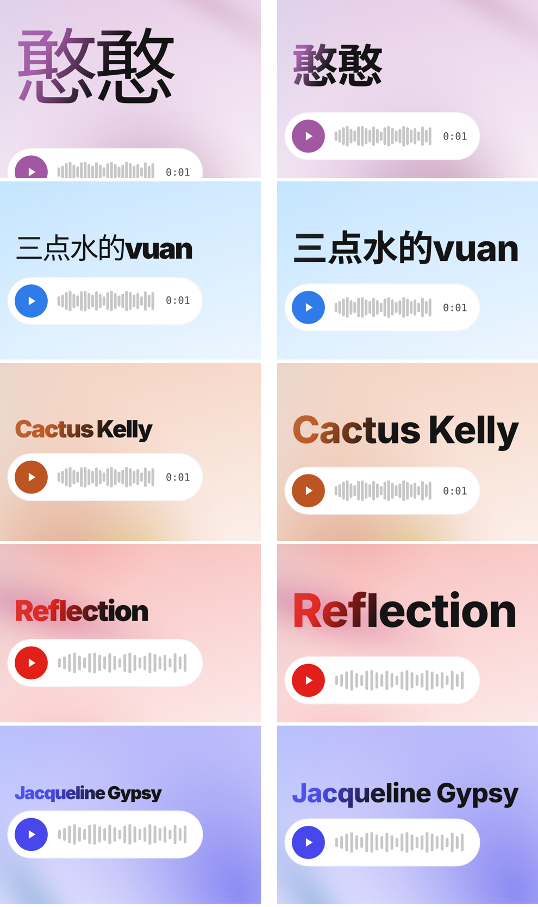
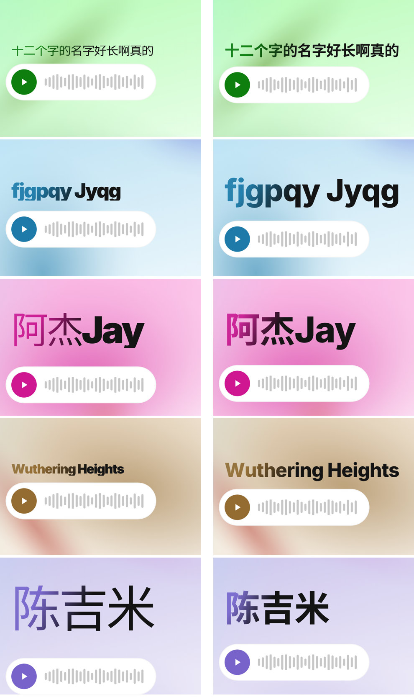
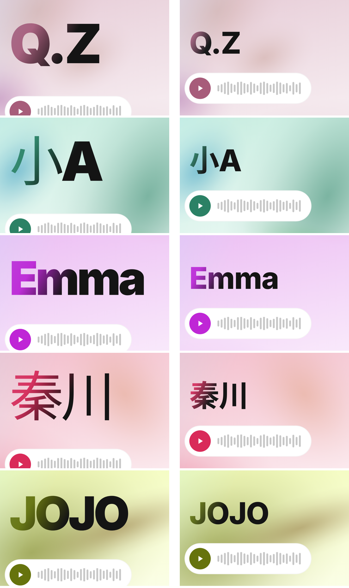
